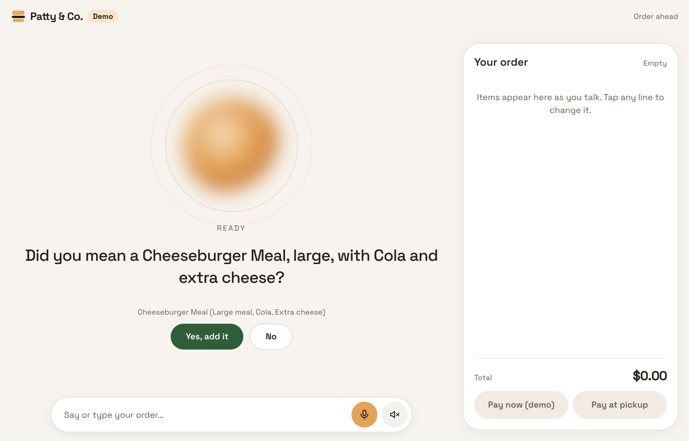
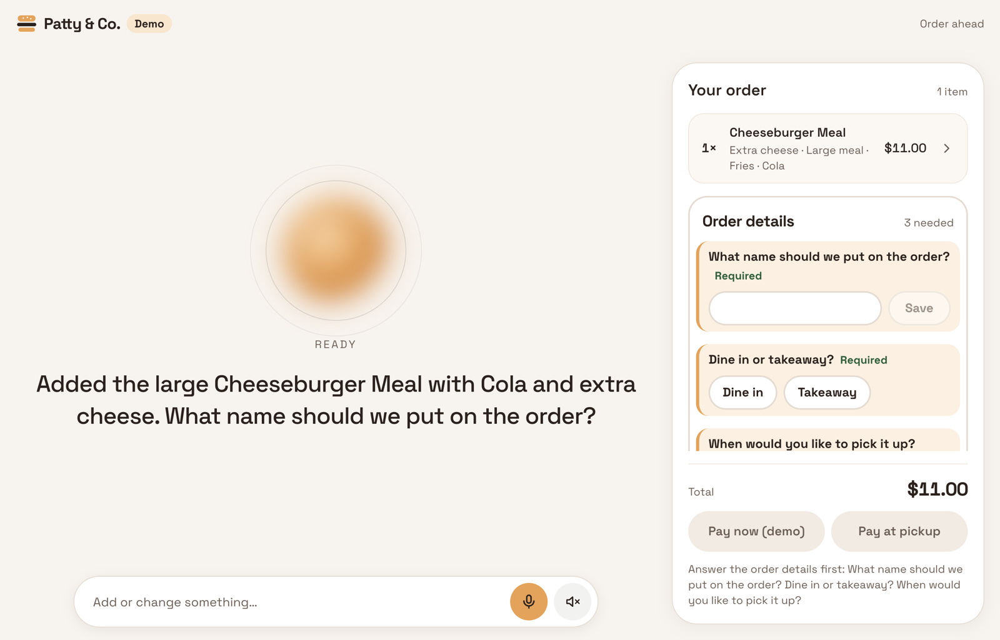
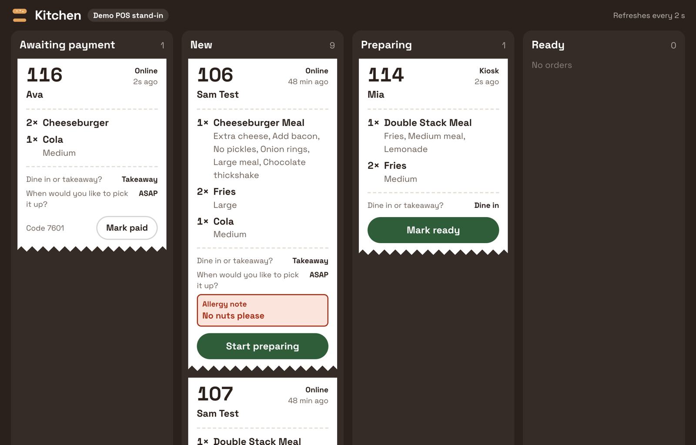

# Food Ordering Agent

Open-source AI ordering agent for restaurants. Customers say or type what they want, the agent builds the order from the restaurant's menu, asks only for missing choices and the owner's questions, and the order goes to the kitchen.

The problem: long queues at the counter, and kiosks where customers scroll through a big menu panel to find what they want. Here they just say it, and the order is built for them.

> Status: runs locally with fictional demo restaurants and a built-in kitchen screen. ElevenLabs voice is tested with a live key. Square is tested in the Square Developer Sandbox: menu read and write, orders, payments and taxes.

## What's in it

- **Agent-only screens**: no menu to scroll. The restaurant keeps its own menu boards and website; customers just say or type their order to the agent (an animated orb shows when it's listening, thinking or speaking).
- **Ordering link**: the agent page restaurants embed on their own website (script snippet), so customers order ahead and skip the line.
- **Kiosk**: built for a portrait screen (a monitor turned 90°, e.g. 1080×1920), with a "Just say what you'd like" start screen; a landscape tablet also works.
- **Confirms guesses**: only items and choices the customer names with the menu's own words (or an alias the owner added) go straight in. A misheard or loose order ("spicy chikken burger", "a coke") gets "Did you mean…?" with Yes/No buttons, and nothing is added until they say yes.
- **Live order**: tap a line to fix it (quantity, options, remove), or talk/type to make bigger changes at any time before paying.
- **Owner questions**: the restaurant decides what to ask (name, dine-in or takeaway, pickup time, allergy note...).
- **Your voice**: in owner settings, set how long replies are (short, medium or detailed), whether the assistant says prices, and a "house style" in your own words (tone, greetings, a line to mention). The ordering rules always come first.
- **Kitchen screen**: a stand-in for the POS while testing.
- **Pluggable AI**: Anthropic (default), OpenAI or OpenRouter, using the restaurant's own key.
- **Voice**: listening uses the browser's speech recognition (free; in Chrome the browser sends the audio to Google for recognition) or ElevenLabs Scribe. Spoken replies come from Kokoro, a free open-source voice that runs on your own server (`TTS_PROVIDER=kokoro`), or from ElevenLabs Flash.

## Stack

- **AI**: Claude Haiku by default, via the AI SDK; OpenAI or OpenRouter also work. The model only changes the order through validated tools.
- **Speech to text**: the browser's built-in speech recognition (free), or ElevenLabs Scribe.
- **Text to speech**: [Kokoro](https://huggingface.co/hexgrad/Kokoro-82M), a free open-source voice model that runs locally on the server's CPU, or ElevenLabs Flash.
- **Database**: embedded Postgres (PGlite) locally with no setup; [Supabase](https://supabase.com) or any Postgres in production.
- **POS**: built-in kitchen screen, or Square.
- **Code**: TypeScript monorepo (pnpm): Hono API, Next.js web app, Zod.

## Quick start

Requires Node 22+ and pnpm.

```sh
pnpm install
cp .env.example .env    # add ANTHROPIC_API_KEY for the agent; set TTS_PROVIDER=kokoro for free spoken replies
pnpm dev
```

Then open the web app (the start page links to everything):

| Page | Path |
| --- | --- |
| Start page | `/` |
| Ordering link | `/order/demo` |
| Kiosk (portrait) | `/kiosk` |
| Kitchen screen | `/kitchen` |
| Owner settings | `/admin` |
| Embed example | `/embed-demo` |

The ordering screens are agent-only, so they need an API key to take orders; without one they show "assistant offline" (the kitchen screen and owner settings still work). Voice needs no paid account: the mic uses the browser's speech recognition (Chrome or Safari) and, with `TTS_PROVIDER=kokoro`, replies are spoken by Kokoro running on your own server (the ~90 MB model downloads on first start). Add `ELEVENLABS_API_KEY` to use ElevenLabs instead. Restart `pnpm dev` after editing `.env`.

Locally, data is stored in an embedded Postgres (PGlite) under `.data/`. Delete that folder to reset.

## Database: Supabase

For a real restaurant, use [Supabase](https://supabase.com) (hosted Postgres with a free plan). It holds the owner's settings, in-progress orders and placed orders, so nothing is lost when the server restarts or redeploys.

1. Create a Supabase project and choose the region closest to the restaurant.
2. Open **Connect** and copy the **Session pooler** connection string. It works on IPv4 networks and suits a long-running server. Put your database password in it.
3. Download the CA certificate from **Project settings → Database → SSL configuration**.
4. In `.env`, set the connection string and the certificate's location:
   ```sh
   DATABASE_URL=postgresql://postgres.<project-ref>:<password>@aws-0-<region>.pooler.supabase.com:5432/postgres
   DATABASE_SSL_CA=/path/to/prod-ca-2021.crt
   ```
5. Restart the server. It creates its tables on first start and logs `Postgres at …pooler.supabase.com (verified SSL)`.

Without `DATABASE_SSL_CA`, add `?sslmode=require` to the URL instead. The connection is still encrypted, but the server's identity isn't checked.

The tables turn on row-level security, so Supabase's public REST API can't read orders or settings. Only this server, which connects as the database owner, can. Any Postgres server works the same way via `DATABASE_URL`.

## Commands

```sh
pnpm test                         # unit tests, no API key needed
pnpm typecheck
pnpm menu                         # print the demo menu
pnpm --filter @foa/agent eval     # grade the real AI agent on both demo menus (needs a key)
pnpm --filter @foa/agent eval bubble-tea   # just one menu; EVAL_VERBOSE=1 prints every conversation
```

## Misheard and mistyped orders

Speech-to-text gets words wrong by sound ("terror milk tea" for "taro milk tea", "chikken" for "chicken"), and typing gets them wrong by spelling. The matching in `packages/core` (`match.ts`, `phonetic.ts`) handles both, and it never adds a guess on its own:

1. **Exact words go straight in.** A menu name, or an alias the owner added ("half sugar"), is added without asking.
2. **Anything else is scored against the menu**, two ways, and the closer one counts:
   - **Spelling**: edit distance, ignoring spaces, so "cheese burgr" is close to "cheeseburger".
   - **Sound**: each phrase becomes a rough code of how it sounds (a simplified Metaphone: sounds spelled differently share a letter, easily confused pairs like b/p and d/t are merged, silent letters are dropped), so "terror" and "taro" get the same code. Sound scores count slightly less than spelling, and very short codes are trusted less.
3. **A close match (score 0.77 or more) is only a suggestion.** The agent asks "Did you mean…?" with Yes/No buttons, and nothing is added until the customer says yes.

   The score is set to 0.77 by default (`HEARD_AS_MIN` in `packages/core/src/match.ts`). You can lower or raise it:
   - **Lower it** (e.g. 0.7) for noisy counters, strong accents or unusual menu names that speech-to-text often gets wrong. The agent catches more mishearings, but also suggests unrelated items more often.
   - **Raise it** (e.g. 0.85) for menus with many similar names (Cola / Cola Zero) or customers who mostly type. Fewer wrong suggestions, but more misheard words are missed and the agent asks the customer to say it again.

   After changing it, run `pnpm test` and the agent eval below to check nothing else moved.

With voice, the browser's speech recognition gives several possible transcripts; the one with the most exact menu words is used.

## Evals: how well the agent orders

Two layers:

- **Unit tests** (`pnpm test`, no API key, run in CI): the cart engine, the matching above, and every expected cart in the eval files (valid on the menu and priced right).
- **Agent eval** (`pnpm --filter @foa/agent eval`, needs a key): runs the real model on 53 cases from `evals/demo-orders.json` (burgers) and `evals/tea-orders.json` (bubble tea):

| Kind | Cases | Passes when |
|---|---|---|
| One-sentence orders | 30 | The cart matches exactly (defaults applied). |
| Misheard orders | 12 | Nothing guessed is added before the customer says yes, then the right cart is built. |
| Conversations | 11 | After each turn: the cart, the choices asked, the offers made, and the reply (length, what it mentions, no prices nobody asked for). |

It prints PASS or FAIL for each case with how long it took (and the agent's tool calls when it fails), then a score per menu, e.g. `Patty & Co. (burgers): 22/22 orders`. It exits with an error if any case fails, so it can run in CI with a key. Use it to compare models or prompt changes, and add a case whenever ordering behaviour changes.

## Demo menus

Both are fictional; all names are original, and prices (AUD) and allergens are made up for testing. Pick one with `DEMO_MENU` in `.env` (`burger`, the default, or `bubble-tea`), then restart `pnpm dev`. The restaurant name comes from the menu until you save one in owner settings.

- **Patty & Co.** (`burger`): a burger shop laid out like a typical quick-service menu: meals, burgers, chicken, sides, drinks, coffee, desserts, a kids pack and breakfast (05:00–10:30). It covers defaults, required choices, choice limits, option prices, time-limited and sold-out items. Burgers link to their meal, so the agent offers the meal once (owner setting "Offer meals").
- **Bramble Tea** (`bubble-tea`): a bubble tea shop. Every drink needs size, sugar and ice with no defaults, so the agent asks for what's missing in one question; toppings are offered once.

How a menu tells the agent what to ask:

| Menu field | What the agent does |
|---|---|
| Group with `min` ≥ 1 and no default | Asks for it. Several missing groups are asked in one question, with buttons for each. |
| Group with a default | Uses the default unless the customer says otherwise. |
| Optional group (`min` 0) with `offer: true` | Offers it once after the item is added ("Any toppings?"). |
| Item with `mealItemId` | Offers the meal once when the item is ordered on its own. |
| Option `aliases` | Other ways customers say it ("half sugar" for "50% sugar"); they count as the exact words, so no "did you mean". |

## Square

Orders can go to a restaurant's Square point of sale. We've tested this in the Square Developer Sandbox (menu read and write, orders, payments, taxes), but test it in your own Sandbox, then with your live account, before taking real orders.

1. At [developer.squareup.com](https://developer.squareup.com), create an application and open its **Sandbox** tab.
2. Put the Sandbox **access token** and a **location ID** in `.env` as `SQUARE_ACCESS_TOKEN` and `SQUARE_LOCATION_ID`.
3. Fill the Sandbox with a demo menu: `pnpm --filter @foa/server square:seed` (add `bubble-tea` for the tea shop, `--reset` to replace what's there).
4. Set `MENU_SOURCE=square` and restart `pnpm dev`. `pnpm --filter @foa/server square:menu` shows how the menu was read.

How it works:

- **Menu**: Square items, variations (as a Size choice) and modifier lists become the agent's menu. Sold-out and variable-price items are left out.
- **Orders and payments**: each order is created in Square as a pickup with the customer's name and kitchen notes, and its payment is recorded once paid (straight away online and at the kiosk, or when staff take payment at the counter).
- **Taxes**: Square applies the seller's taxes. Tax added on top of prices (e.g. US sales tax) is shown in the total before paying.
- **If Square is down**, the order still goes through and shows on our kitchen screen with a warning.

## Layout

```
packages/core    menu schema, cart engine, search, owner questions, shared API types, demo menu
packages/agent   LLM agent: tools, prompt, provider choice, eval runner
apps/server      API (Hono), database, POS adapter
apps/web         ordering link, kiosk, kitchen screen, owner settings, embed script
evals            sample orders and expected carts
```

## Contributing

See [CONTRIBUTING.md](CONTRIBUTING.md). Security reports: [SECURITY.md](SECURITY.md).

## Licence

[Apache-2.0](LICENSE)

## Screenshots

The agent confirms a guess before adding it ("Coke" isn't on the menu, so it asks about Cola):



The live order card, with the owner's order questions:



The kitchen screen (a stand-in for the POS):


